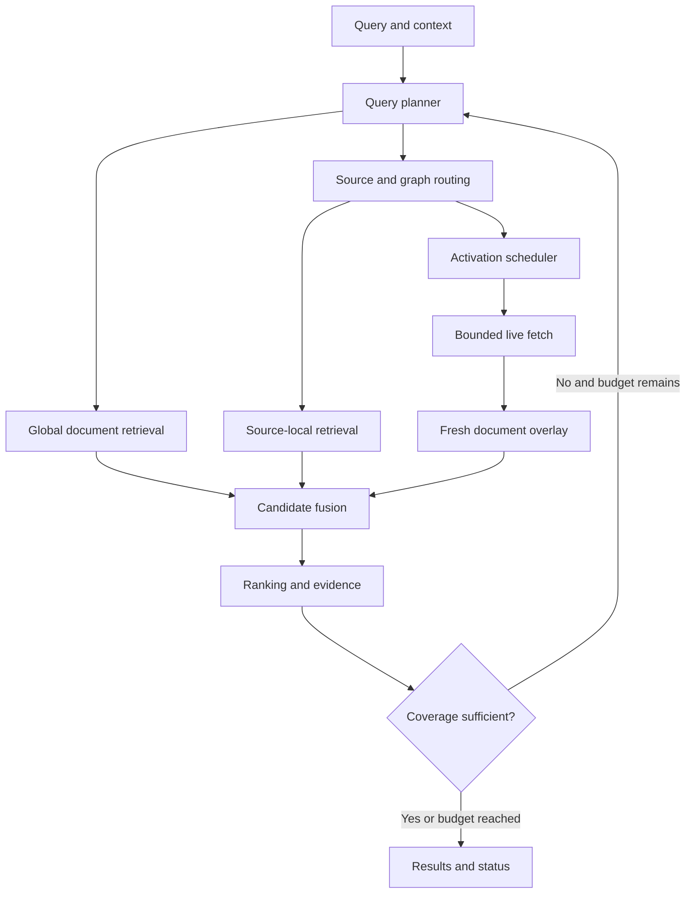
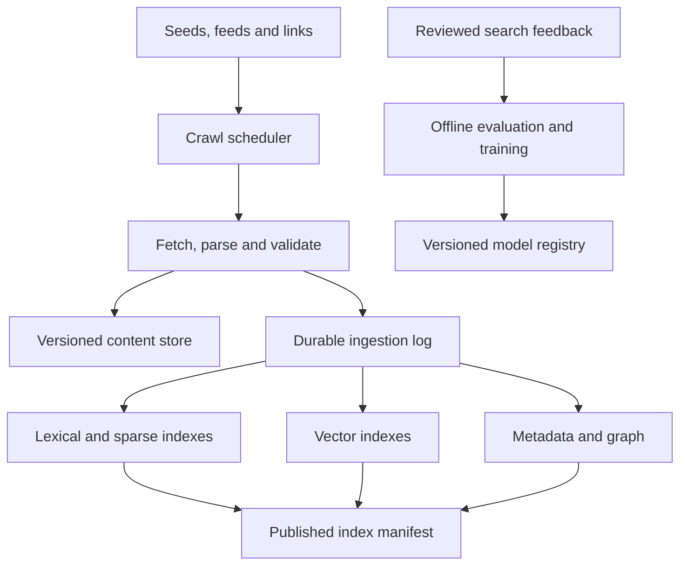

# Search Engine Algorithm Architecture

Version: 2.0 · Research reviewed: 7 October 2026

Status: implementation design, not a measured performance report. This document expands the supplied Search Engine Core Algorithm into an end-to-end engine specification. Algorithm descriptions have primary-source references; the combined architecture, policies, budgets, and rollout gates are proposed engineering choices. Numerical defaults must be tuned on the actual corpus, hardware, and traffic.

Implementation status as of 2026-10-09: see §26 — sections 6–18 are implemented in `crates/engine` and served over HTTP; §26 records what is real versus proxied and the live measurements behind that claim.

## 1. Purpose and design decisions

Build an independent search engine that accepts natural-language queries, conversation context, explicit constraints, freshness requirements, and a search mode. Return ranked documents and URLs with attributable evidence, timestamps, coverage, and an honest description of incomplete retrieval.

The engine owns its crawl frontier, source catalog, indexes, and ranking. It does not require a general-purpose search API. Authorized source-specific feeds and APIs can supplement its crawler. Independence does not imply complete web coverage: results are bounded by discovered, accessible, indexed sources and the current query's discovery budget.

The governing objective is:

```text
maximize expected relevance + constraint satisfaction + evidence coverage
subject to latency, compute, network, access, and freshness constraints
```

Key changes from the initial draft:

| Initial approach | Revised decision | Reason |
|---|---|---|
| Select sources before searching documents | Run global document retrieval and source routing in parallel | A mistaken source choice must not eliminate all relevant documents |
| Normalize every raw score to 0–1 and sum | Start with rank fusion; train a ranker when labels exist | Per-query min–max normalization is unstable and does not create calibrated probabilities |
| Use dense search mainly for sources | Search passages too, where affordable | A source description cannot represent every topic in its documents |
| Use an agent when top scores are close | Escalate on calibrated failure risk and expected benefit | Close results may be equally relevant; a large gap may still be confidently wrong |
| Treat source check time as freshness | Track document verification and event/publication time separately | Checking a homepage does not verify an article or a claim |
| Treat MUVERA/WARP as interchangeable rerankers | Evaluate them as distinct multi-vector retrieval backends | Their representations, training assumptions, and indexing differ |
| Stop when the top result beats an unexplored path | Use bounded stopping or explicit heuristic stopping | Scores from unrelated stages are not comparable upper bounds |
| Assume LLM choices are inherently fast | Use cached policies, small classifiers, and bounded LLM fallback | Prompt processing, queues, and model execution dominate short outputs |

## 2. System topology

The online coordinator serves requests. Background ingestion builds the searchable world. A learning pipeline improves both without changing production weights after every click.





Use a modular monolith with background workers for the first deployment. Separate services only when resource isolation, throughput, or fault boundaries justify the operational cost.

## 3. Request and response contracts

```typescript
type SearchRequest = {
  query: string;
  context: ContextTurn[];
  mode: "fast" | "auto" | "deep";
  limit: number;
  locale: string;
  timezone: string;
  as_of?: string;
  filters: StructuredFilters;
  freshness: { max_verification_age_ms?: number; strict: boolean };
  deadline_ms?: number;
  scope: AccessScope; // supplied by trusted authentication middleware
};

type SearchResponse = {
  results: SearchResult[];
  coverage: { unit_id: string; status: "supported" | "contradicted" | "unknown" }[];
  status: "complete" | "partial" | "no_matches" | "needs_clarification";
  stop_reason: string;
  freshness_status: "satisfied" | "mixed" | "unverified";
  unavailable_lanes: string[];
  snapshot_id: string;
  timing_ms: Record<string, number>;
  continuation?: string;
};
```

Each result includes stable document/version IDs, canonical URL, title, snippet, passage citations, source, publication/event/verification times where known, lane provenance, and eligibility status. Return fewer than the requested number when there are insufficient eligible results. `complete` means the configured search procedure completed; it is not a claim that the entire web was searched.

## 4. Persistent data model

| Record | Required fields and purpose |
|---|---|
| Source | Stable ID, origin/path scope, type, topic profiles, language, feed/sitemap endpoints, owner/publisher identity where known, fetch rules, refresh history |
| Document | Stable ID, source ID, canonical URL, access scope, current version, tombstone, duplicate cluster, language, content type |
| DocumentVersion | Content hash, extracted text, fetch time, last successful verification, publication time, modified time, event time, parser/model versions, raw snapshot reference |
| Passage | Document version, section path, text offsets, token range, parent section, embedding/sparse representation version |
| Entity | Stable ID, aliases, entity type, disambiguation features; no name-only identity joins |
| GraphEdge | Typed endpoints, weight, confidence, valid time, provenance, last observed time |
| Evidence | Exact passage/version reference, claim or constraint ID, subject ID, stance, confidence, supporting span |
| IndexManifest | Searchable generation, segment IDs, embedding model IDs, metadata version, ingestion watermarks |
| PolicyTrace | Actions available/selected, probabilities when applicable, cost, outcome, model version, scope-safe request features |

Preserve unknown timestamps as unknown. Do not replace them with the crawl time. Maintain historical versions for reproducible evidence and explicit historical queries.

Source profiles should represent topic mixtures rather than one averaged embedding. Large hosts may need profiles per repository, publication, forum, or path. A whole hosting domain is rarely one coherent source.

## 5. Discovery, crawling, and ingestion

### 5.1 Build coverage before query time

Bootstrap from curated official sites, known repositories, sitemaps, RSS/Atom feeds, permitted datasets, and user-submitted sources. Discover additional links from fetched documents. New domains enter a validation queue and retain low-confidence metadata until inspected.

A background crawl frontier ranks work using a proposed utility estimate:

```text
crawl_utility(url) =
  expected_query_demand × probability_of_useful_new_content × expected_value
  / max(estimated_fetch_and_processing_cost, epsilon)
```

Reserve crawl capacity for underrepresented topics and new domains so existing popularity does not permanently determine coverage. Respect per-origin concurrency, backoff, robots directives, access restrictions, and response sizes. RFC 9309 defines the robots protocol; robots permission is not authentication or a content license [R12].

### 5.2 Process content deterministically

1. Validate URL, destination, redirects, access scope, and fetch policy.
2. Fetch with validators when available; retain ETag and Last-Modified [R13].
3. Extract main content, headings, tables, code, links, author and time metadata.
4. Detect language, malformed content, boilerplate, spam indicators, and parser errors.
5. Canonicalize conservatively. Do not remove URL parameters that change content.
6. Hash content; identify exact duplicates and near-duplicates using fingerprints plus verification.
7. Chunk by semantic structure. Start around 200–500 tokens, but keep code blocks, table headers, and section boundaries intact where practical.
8. Store parent sections so ranking can retrieve a small passage and evidence extraction can expand its context.
9. Produce lexical terms, optional sparse weights, dense embeddings, and provenance-backed entity links.
10. Publish searchable representations through an idempotent ingestion log.

OCR and browser rendering use separate cost-limited queues. A broken parser must not silently replace a good indexed version with empty text.

### 5.3 Incremental indexing

Use immutable base segments plus a mutable recent-document overlay. Assign updates monotonically ordered versions per document. On merge, the latest authorized version wins; tombstones override all older copies.

The lexical lane may expose a new document before its embedding is ready. Record lane watermarks and merge by version, rather than requiring every representation to publish simultaneously. Pin a manifest for the request and explicitly include any approved live overlay versions. Never attach text from version B to a vector hit whose evidence offsets refer to version A.

Persist live discoveries before acknowledging durable indexing. Use idempotency keys based on document ID, content hash, and representation version. Replay failed index jobs; periodically compact overlays. Rebuild embedding indexes side by side when changing embedding models, then atomically switch the manifest.

## 6. Query analysis and belief state

Keep the original query immutable. Produce normalized text, language, exact phrases, entities, concepts, hard predicates, soft preferences, temporal intervals, intent, and a bounded query-unit dependency graph.

Use Unicode normalization, language-aware tokenization, spelling suggestions, and alias lookup. Preserve significant punctuation and case for symbols, identifiers, version numbers, error codes, and quoted strings. Search the original form alongside any correction.

Resolve relative dates using the request's timezone and query start time. “Today” becomes a local calendar interval, then UTC boundaries for storage. A freshness window and an event-date filter are separate constraints.

```typescript
type SearchState = {
  original_query: string;
  plan: QueryPlan;
  beliefs: EntityHypothesis[];
  frontier: ActionHeap;
  active_sources: Set<string>;
  candidates: Map<string, Candidate>; // document ID plus resolved version
  evidence: EvidenceGraph;
  completed_action_keys: Set<string>;
  inflight: TaskRegistry;
  snapshot: IndexManifest;
  budget: AtomicBudgetLedger;
  stop_reason?: string;
};
```

Entity linking retains several hypotheses. For example, “Apple” may mean a company, fruit, or a record label. Use alias priors, local context, entity types, and retrieved evidence to update the distribution. Always keep an “unknown/other” hypothesis. Avoid treating repeated copies of one article as independent evidence.

A routing classifier estimates direct, semantic, ambiguous, and multi-hop query classes. These are features, not rigid rules: a short query can require difficult freshness work, and a long exact-title query can be easy. Adaptive-RAG supports complexity-based selection with a smaller model; this architecture adapts that principle to search and does not use an LLM's internal knowledge as a substitute for requested documents [R9].

## 7. Constraint decomposition and evidence joins

Decompose only when relationships or several independent requirements justify it. Represent dependencies explicitly:

```text
Find developers who moved from hosted APIs to local models because of cost,
and identify the GPUs they subsequently bought.

U1: identify migration event and person/project
U2: establish cost as a stated reason for that event
U3: establish destination as local model inference
U4: identify hardware purchase/use after that migration
join key: verified person/project identity + migration event
```

Independent retrieval can find candidates for U1–U4, but final evidence must refer to the same entity and compatible time sequence. Four unrelated documents do not establish a complete answer. A name match alone is insufficient to join two people.

Classify constraints as:

| Kind | Treatment |
|---|---|
| Trusted access scope, explicit domain/language/date filters | Enforce before exposure and recheck at finalization |
| Exact phrase, identifier, version | Preserve lexical checks; report missing evidence |
| Semantic requirement such as “because of cost” | Verify with passage evidence; use supported/contradicted/unknown |
| Preference such as “first-person posts preferred” | Ranking feature unless the user makes it mandatory |

For each required unit, track confidence, evidence provenance, contradiction, and independence. High average coverage never overrides an unsatisfied mandatory predicate.

## 8. Query planning and resource allocation

Build a physical plan from query features, index statistics, filter selectivity, queue pressure, and measured lane performance.

```text
plan = {
  lanes, per_lane_top_k, source_route_count,
  ANN_search_effort, sparse_term_budget,
  rerank_count, refresh_count,
  query_variants, model_allowance,
  absolute_deadline, stage_deadlines
}
```

Start with conservative rules. Later train a cost model that predicts latency and marginal relevance gain. Allocate extra work where expected gain per cost is highest. Keep an exploration allowance for unfamiliar sources and uncertain interpretations.

Avoid universal fan-out: an exact error-code query may need lexical retrieval and a small rerank; a conceptual query may justify dense and sparse lanes. The normal plan still keeps a global recall path instead of making source routing an irreversible gate.

Initial query expansion can include aliases and a small number of semantic variants. Search the original query in its own lane. Cap expansions, record their origin, and reject rewrites that remove negation, identifiers, dates, or mandatory constraints. Pseudo-relevance feedback is optional and must draw from several trustworthy top results; otherwise it amplifies the first retrieval error.

## 9. Retrieval lanes and internal algorithms

### 9.1 Lexical retrieval

Use a fielded inverted index with positional postings. Score title, headings, body, anchor text, and URL fields with BM25-based scoring and explicit phrase/identifier features.

Use compressed postings and block-level score bounds. WAND, Block-Max WAND, and Block-Max MaxScore skip work that cannot beat the current top-k threshold under the supported scoring function. Lucene's implementation history shows that the best pruning strategy depends on query structure and k; do not assume one variant wins universally [R1].

Bounds must include relevant scoring contributions and match the index's supported scoring semantics. Arbitrary late neural boosts cannot be silently included in an otherwise “exact” pruning guarantee. Static term pruning and approximate early termination can lose candidates and must be separately labeled and measured.

For an MVP, rely on an established search library's implementation. Building a new postings engine is unlikely to be the best first use of engineering time.

### 9.2 Learned sparse retrieval

SPLADE-style encoders produce sparse weighted vocabulary representations and can bridge lexical mismatch. Precompute document weights; cache query representations. SPLADE-v3 reports improvements on its evaluated retrieval sets, but model quality and runtime must be validated on this engine's corpus [R2].

Keep lexical retrieval independent because expansion can mishandle exact identifiers or domain-specific meanings. Limit activated query terms and measure the recall/latency curve. Document-side pruning changes both storage and recall.

If sparse retrieval becomes the measured bottleneck, benchmark Block-Max Pruning (BMP), which was developed for learned sparse indexes [R3]. Do not equate sparse dimensionality with low execution cost: many active terms can traverse many postings.

### 9.3 Dense document and passage retrieval

Choose based on working-set size and hardware:

| Situation | Candidate implementation | Tradeoff |
|---|---|---|
| Small corpus or tiny filtered subset | Exact vector scan | Simple, reproducible, sometimes faster than ANN overhead |
| RAM-resident vectors | HNSW | Good practical speed/recall tradeoff; graph memory and updates need measurement |
| Tight storage/memory budget | IVF with vector quantization | Compression and search effort trade recall for resources |
| Large SSD-backed collection | DiskANN family | Adds I/O and cache tuning; attractive when vectors exceed RAM |
| Restrictive metadata filters | Filter-aware traversal or exact subset scan | Avoids losing eligible neighbors after naive post-filtering |

HNSW provides hierarchical graph navigation [R4]. DiskANN targets large-scale vector retrieval [R5]. ACORN addresses vector retrieval with structured predicates [R6]. They solve related but different deployment problems.

Use the embedding model's intended distance metric. Preserve model versions; do not compare embeddings from incompatible encoders. Search passages and aggregate to documents with bounded passage contributions so long documents do not win merely by having more chunks.

Estimate the number of eligible vectors before choosing an execution strategy. Post-filtering a small ANN top-k can return too few results even when eligible neighbors exist. Increase search effort within budget, use a filter-aware backend, or scan the eligible subset. Apply access controls throughout the path; final filtering alone must not leak unauthorized snippets or counts.

### 9.4 Entity and graph retrieval

Maintain typed adjacency lists for entity–alias, entity–document, concept–source, source–document, citation, and explicit relation edges. A separate graph database is optional; compact adjacency arrays and metadata tables are enough initially.

A bounded personalized activation process can use:

```text
activation_next = alpha × query_seed + (1 - alpha) × P^T × activation
```

Here P is a normalized transition matrix over allowed edge types. Define dangling-node behavior, limit visited edges, and prune low-mass nodes. Use local sparse updates rather than multiplying across the whole graph. Cap high-degree hubs and retain edge provenance. Activation is a retrieval prior, never evidence that a claim is true.

### 9.5 Source retrieval

Rank source profiles using lexical/dense similarity, query-type fit, entity links, expected fresh evidence, and historical utility. Search top source partitions in parallel with the global document lanes.

Use routing as an accelerator and discovery aid. Apply strict source restriction only when requested by the user or required by access scope. Otherwise preserve a global candidate quota and record relevant results that source-only retrieval would have missed.

### 9.6 Freshness retrieval

Query a recent-document overlay and time-indexed metadata. Retrieve feed entries, releases, and newly changed pages from activated sources when necessary. Recent documents still have to match the query; freshness alone is not relevance.

## 10. Candidate fusion and ranking cascade

Map passage hits to document/version IDs, enforce mandatory structured predicates, and deduplicate before document-level fusion. Preserve each lane's best passage and lane rank.

Start with weighted reciprocal rank fusion [R7]:

```text
RRF(d) = sum over participating lanes l of w_l / (c + rank_l(d))
```

Missing documents contribute zero. Ranks begin at one. Start with c around 60 as a tuning candidate, not a calibrated confidence. Lane weights and retrieval depths require validation. Prevent numerous near-identical query rewrites from outvoting the original query: fuse within a variant family first or cap that family's total weight.

A proposed cascade is:

| Stage | Illustrative count | Work |
|---|---:|---|
| Parallel retrieval | 100–300 hits per active lane | Cheap broad recall |
| Union and version resolution | Up to 1,000 unique documents | Eligibility, fusion, duplicate grouping |
| Feature ranker | Up to 300 | Fast relevance, source/type/time, constraint features |
| Cross-encoder or late interaction | 40–100 documents | Expensive semantic matching of selected passages |
| Evidence verification | 10–30 documents | Required predicates, relation joins, contradictions |
| Diversification | Requested count | Remove redundant stories and preserve useful viewpoints |

All counts are initial knobs. Under a short deadline, reduce expensive stages while retaining an eligible lexical fallback.

Train a learning-to-rank model when judgments are available. Features include lane ranks and raw scores, exact matches, passage relevance, type fit, query-dependent source trust, verified freshness, and evidence coverage. Missing-lane indicators are explicit features. Avoid a large universal authority boost that suppresses firsthand experience or new sources.

A reranker cannot recover documents that never reached its candidate set. Evaluate candidate recall separately from ranking quality.

## 11. Multi-vector retrieval options

ColBERTv2 is a late-interaction approach that preserves token-level matching while compressing representations [R8]. A typical scoring form is:

```text
score(q, d) = sum over query tokens i of max over document tokens j similarity(q_i, d_j)
```

It is an alternative retrieval/ranking branch, not a mandatory stage after every cross-encoder.

MUVERA converts multi-vector similarity search into fixed-dimensional vector search, enabling an initial maximum-inner-product search followed by more precise multi-vector scoring [R10]. Evaluate encoding dimension, storage, ANN recall, and exact rescoring cost together.

WARP optimizes retrieval for models trained with the XTR objective through similarity imputation, implicit decompression, and efficient aggregation [R11]. It is not a generic drop-in cross-encoder replacement. Evaluate its compatible model/index/runtime as one system.

Run these alternatives against the existing hybrid-plus-cross-encoder baseline. Published speedups compare particular datasets, hardware, and reference implementations; they are not this engine's latency forecast. Adopt one only if it improves the measured quality/cost frontier.

## 12. Fast LLM selection

### 12.1 Decision hierarchy

Use the least costly method that achieves the required decision quality:

| Level | Mechanism | Role |
|---|---|---|
| 0 | Rules, exact routing, versioned policy cache | Known identifiers, explicit filters, repeated decisions |
| 1 | Small encoder classifier or feature model | Complexity, intent, source family, stop/escalate |
| 2 | Small local instruction model | Ambiguous action selection and limited decomposition |
| 3 | Larger bounded planner | Rare multi-hop searches in deep mode |

Distill reviewed decisions and outcomes from more capable models into the cheaper classifier. Learn which action succeeded, rather than merely imitating a model's preferred action.

### 12.2 Restrict the action space

The coordinator proposes validated actions. An action specifies existing source/path/query-unit IDs and a reserved resource budget:

```json
{
  "query": "Apple health problems",
  "context_summary": "The user is discussing a backyard fruit tree.",
  "uncovered_units": ["cause", "symptoms"],
  "actions": [
    {"id": "A", "kind": "expand", "path_id": "apple_tree_disease"},
    {"id": "B", "kind": "expand", "path_id": "apple_health_apps"},
    {"id": "C", "kind": "widen", "lane_id": "global_lexical"},
    {"id": "D", "kind": "abstain"}
  ]
}
```

The selector returns one constrained ID. JSON or enumerated decoding can enforce output shape; it cannot guarantee a good choice. vLLM documents choice-constrained structured output [R14]. Validate that the action is still legal when execution begins, because budgets or state may have changed while inference ran.

Never accept an arbitrary model-generated URL as a verified discovery. New fetchable URLs must originate from allowed seeds, parsed links, or authorized source endpoints and pass the URL validator.

### 12.3 Reduce latency where it actually occurs

Keep selection prompts short, with a fixed schema and bounded candidate summaries. Use a non-reasoning selector configuration where available; do not request a generated essay to choose an action. For choices, prefer a classifier head or scoring predefined labels when the serving stack supports it.

Warm model weights, cap batching wait, and reserve capacity to prevent search requests queueing behind long generation. Quantization is a candidate optimization subject to decision-quality tests. Cache compatible static prompt prefixes: vLLM prefix caching avoids repeated prefill work on shared prefixes, not all inference work [R15].

If using single-token labels, verify the tokenizer and measure positional/label bias. For multi-token labels, compare complete label sequence scores appropriately rather than only the first token. Model likelihood and self-reported confidence are not calibrated correctness probabilities.

Illustrative policy: cap input at 1,000 tokens, output at 16 tokens, and auto-mode calls at one. These are resource bounds, not a promise of millisecond inference. Bypass the model if queueing plus estimated runtime exceeds the remaining deadline. Speculative decoding primarily targets longer generation; it is not the first optimization for a one-label selector.

### 12.4 Escalation criterion

```text
escalate only if:
  important uncovered constraint or unresolved interpretation
  AND predicted quality gain exceeds compute/latency cost
  AND an admissible action could resolve the gap
  AND deadline and model budgets permit it
```

Estimate failure risk with held-out labels using retrieval agreement, evidence support, missing units, interpretation entropy, and model uncertainty. Calibrate the decision model. Do not interpret an RRF score, cosine similarity, or top-two margin as a universal probability.

## 13. Data activation and refresh scheduling

Activation means deciding which data to make ready and which sources to refresh. It is distinct from relevance ranking and from persistent crawling.

Three levels of activation:

| Level | Action | Typical use |
|---|---|---|
| Representation | Load cached profiles, postings blocks, vector pages, parent sections | Reduce avoidable I/O |
| Retrieval | Allocate candidates to a source, topic, partition, or query unit | Search promising areas more deeply |
| Fresh data | Fetch a feed, revalidate a page, parse newly discovered URLs | Resolve an actual freshness or coverage gap |

Track source state as `cold`, `ready`, `refreshing`, `ready_with_error`, or `backoff`, with separate watermarks for feed coverage and individual document verification. Do not let one successful page fetch mark an entire source fresh.

A proposed action value model is:

```text
value(a) = P(useful independent evidence | state, a) × expected coverage gain
           + expected freshness gain + bounded exploration bonus
           - lambda_ms × estimated latency
           - lambda_compute × estimated compute
           - lambda_bytes × estimated network use
```

Train comparable utility estimates; do not add arbitrary uncalibrated scores. Use a simple heuristic first, and log its components. Schedule top positive-value actions subject to per-origin limits and query budgets. Batch independent actions, coalesce duplicate refresh requests, and cancel or detach safely when the originating search ends.

Start with small live-fetch fan-out, such as 2–4 concurrent origins in auto mode. Eight fetches can be a total cap, not eight simultaneous requests to one origin. Browser rendering consumes a separate scarce budget.

## 14. Freshness semantics

Maintain at least:

```text
published_at      when the document says it was published
modified_at       declared modification time
fetched_at        when bytes were retrieved
verified_at       when that URL was last successfully revalidated
event_time        when the discussed event happened, if established
feed_watermark    how far discovery through that feed has progressed
```

Re-fetching an old page does not make its facts current. A conditional 304 response verifies that the server's representation has not changed according to its validator; it does not prove the statement is true or that no newer page exists [R13].

Use document/topic volatility, observed change history, query demand, and the query's required verification age to schedule refresh. A basic change model can estimate `P(changed since t) = 1 - exp(-rate × age)`; this is a simplifying assumption and should yield to empirical schedules for bursty sources.

Apply freshness as an eligibility rule when explicitly required and as a query-dependent feature otherwise. For strict current queries, return partial/unverified status if refresh fails. For historical queries, match the requested time and avoid replacing historical evidence with today's state.

## 15. Looking strategies and the action frontier

The frontier holds executable actions rather than only graph paths:

```typescript
type SearchAction = {
  id: string;
  kind: "retrieve" | "expand_graph" | "refresh" | "follow_link"
      | "rerank" | "verify_join" | "widen";
  hypothesis_id: string;
  target_id: string;
  query_unit_ids: string[];
  expected_gain: number;
  estimated_cost: ResourceCost;
  depth: number;
  provenance: string[];
};
```

| Situation | Strategy |
|---|---|
| Exact identifier or navigational query | Direct indexed lookup, lexical retrieval, small candidate validation |
| Ordinary conceptual query | Parallel hybrid retrieval and best-first additional work |
| Ambiguous entity | Beam across interpretations, with a reserved slot per credible interpretation |
| Relational multi-hop query | Dependency-aware retrieval, evidence joins, bounded backtracking |
| Current-events query | Recent overlay plus selected feed refresh and independent verification |
| Low recall or unknown topic | Broaden global retrieval, aliases, and new-source discovery |

For ambiguity, choose beam width based on uncertainty and budget; start with 2–4 interpretations. Keeping the globally highest-scoring paths alone can fill every slot with one interpretation, so enforce hypothesis diversity. Drop a hypothesis when evidence resolves it, not merely because a popular source accumulates more copies.

Use an exact visited/action-key set within a request. Keys include normalized query variant, target, filter scope, and relevant index version. Detect cycles and penalize redundant expansions. A probabilistic structure with false positives is unsuitable for correctness-critical access or evidence deduplication.

Multi-hop retrieval alternates discovery and verification: search for migration accounts, bind candidate identities, then retrieve hardware evidence for each bound identity. Parallelize independent people/projects, not dependency steps that lack a join key.

Monte Carlo tree search and unrestricted autonomous browsing are research options only after simpler frontier policies show a measurable limitation. Their rollout cost and unverifiable value estimates make them poor defaults for a latency-sensitive engine.

## 16. Evidence scoring and diversity

Extract evidence from preserved passages, not generated source summaries. For each claim record supported, contradicted, or unknown, the exact text span, document version, entity binding, and time scope. A semantic verifier may assist, but deterministic checks validate IDs, dates, quotations, and source offsets.

```text
coverage = sum(unit_weight × supported_indicator) / sum(unit_weight)
```

Also require every mandatory unit to pass individually. Track independent origins rather than counting syndicated copies as corroboration. Present disagreements when trustworthy evidence conflicts; do not manufacture a single answer by averaging incompatible facts.

Diversify eligible results using a greedy maximal-marginal-relevance style objective:

```text
utility(d | selected) = relevance(d)
                       + uncovered_unit_gain(d)
                       - redundancy_penalty(d, selected)
```

Use duplicate/story clusters, source ownership where known, and semantic overlap. Allow multiple results from one domain for explicit site searches or complementary official sections. Domain diversity alone does not establish independent reporting.

Optional answer generation occurs after search and consumes the selected evidence bundle. It must not alter document eligibility, invent citations, or conceal search gaps.

## 17. Budgets, deadlines, and stopping

The following are initial design targets to test, not achieved SLOs:

| Budget | Fast | Auto | Deep |
|---|---:|---:|---:|
| Overall server deadline | 200 ms | 3 s | 20 s |
| First indexed-results target | 200 ms | 300 ms | 500 ms |
| Global document lane count | 1–3 | 2–4 | 2–5 |
| Graph edge visits | 100 | 1,000 | 10,000 |
| Sources searched in detail | 10 | 30 | 100 |
| Live fetches total | 0 | 8 | 30 |
| Generative selector calls | 0 | 1 | 4 |
| Reranked document cap | 30 | 100 | 300 |
| Retrieval rounds | 1 | 2 | 5 |

The client may impose a tighter deadline. Reserve finalization time before scheduling work. Charge the ledger atomically before dispatch: candidate limits, tokens, fetches, bytes, and concurrent tasks all matter. Shared refreshes need explicit attribution; coalescing must not bypass source rate limits.

Stop on deadline or budget exhaustion, sufficient supported coverage, no admissible positive-value action, or explicit cancellation. A plateau rule such as “two rounds without evidence improvement” is a heuristic and must be logged as such.

Exact top-k stopping requires valid upper bounds in the same scoring system as the retained kth result. ANN results, neural reranker scores, and predicted frontier utility generally do not provide such bounds. Return a partial result with the stop reason instead of asserting proven optimality.

Latency accounting follows the critical path:

```text
T_total = T_parse
        + max(T_active_initial_lanes)
        + T_fusion_and_ranking
        + T_required_followup_critical_path
        + T_finalize
```

Parallel tasks still contend for CPU, memory, GPU, and I/O. Stage p95 values do not simply sum to the overall p95. Measure end-to-end distributions under realistic concurrency, including queueing and cold caches.

## 18. Coordinator pseudocode

The pseudocode defines responsibilities and ordering; helper functions are service contracts, not an executable implementation.

```python
async def search(request):
    scope = authenticate_and_resolve_scope(request)
    budget = make_atomic_budget(request.mode, request.deadline_ms)
    snapshot = pin_index_manifest(scope)
    analysis = analyze_query(request, snapshot)
    state = new_state(request, analysis, snapshot, scope, budget)

    cache_hit = eligible_cached_response(state)
    if cache_hit is not None:
        return revalidate_and_finalize(cache_hit, state)

    plan = build_plan(state)
    # Tasks have stage timeouts shorter than the overall deadline.
    initial_tasks = reserve_and_launch(plan.initial_actions, state)
    try:
        while True:
            completed = await collect_until_next_stage_boundary(state.inflight)
            for outcome in completed:
                if outcome.failed:
                    record_lane_failure(state, outcome)
                    continue
                candidates = validate_versions_scope_and_provenance(outcome, state)
                merge_candidates(state, candidates)

            if new_candidates_exist(state):
                fused = deduplicate_and_fuse(state)
                ranked = await bounded_rank(fused, state)
                update_evidence_and_join_coverage(ranked, state)
                retain_best_eligible_results(state, ranked)
                maybe_emit_provisional_results(state)

            reason = stopping_reason(state)
            if reason is not None:
                state.stop_reason = reason
                break

            actions = admissible_next_actions(state)
            # Cheap utility policy first; LLM only when worthwhile and allowed.
            choice = choose_with_cached_or_small_policy(actions, state)
            if should_escalate(choice, actions, state):
                choice = await bounded_selector_or_fallback(actions, state)

            # Revalidate legality and atomically reserve before any side effect.
            launched = reserve_and_launch(choice, state)
            if not launched and not state.inflight:
                state.stop_reason = "no_admissible_actions"
                break
    finally:
        cancel_query_owned_tasks(state)
        detach_shared_refreshes_under_background_budget(state)

    results = diversify(state.best_results, analysis)
    results = recheck_current_access_and_tombstones(results, scope)
    response = finalize_with_gaps_times_and_stop_reason(results, state)
    enqueue_scope_safe_trace(state)
    return response
```

A request with no successful neural lane must still return its best eligible lexical results. A request with no candidates must still consider allowed widening/refresh before declaring `no_matches`. No blocking wait is allowed to extend beyond the remaining deadline.

## 19. Service boundaries

| Interface | Input | Output / invariant |
|---|---|---|
| QueryAnalyzer | Query, bounded context, time, scope | Typed plan; original query preserved |
| Retriever | Representation, filters, snapshot, k, deadline | Candidate IDs/versions, scores, provenance, completeness |
| SourceRouter | Query features and source profiles | Ranked sources plus uncertainty |
| ActivationScheduler | Actions and ledger | Admitted tasks; origin limits enforced |
| Fetcher | Validated URL, scope, validators | Bounded response or explicit failure |
| Indexer | Versioned ingestion event | Idempotent per-lane acknowledgement |
| Ranker | Candidate features and passages | Ordered candidates with model version |
| EvidenceVerifier | Units, passages, identity bindings | Support/contradiction/unknown and exact spans |
| Selector | Compact state and admissible actions | Valid action ID or abstention |
| Finalizer | Best eligible results and trace summary | Stable response; gaps and freshness visible |

## 20. Caches and consistency

Cache query encodings, source profiles, posting/vector pages, reranker features, and exact request results separately. Each cache has an owner and invalidation rule.

An exact result-cache key includes normalized query, relevant context hash, filters, locale/timezone, resolved temporal interval, access-scope version, index manifest, ranking policy, and freshness requirement. Time-sensitive requests need short validity or revalidation. Cache only safe, bounded context; do not embed arbitrary private conversation text into shared cache keys or logs.

Semantic caches may reuse plans or candidates, but must recheck constraints, dates, versions, and access. Similar phrasing does not imply the same question: “before 2024” and “after 2024” cannot share an answer.

Cache negative results briefly and invalidate them when relevant ingestion advances. Coalesce identical in-flight retrieval and refresh jobs. Restrict cross-tenant cache reuse to public data and policy-approved cases.

## 21. Reliability and trust boundaries

| Failure | Required behavior |
|---|---|
| Encoder or GPU unavailable | Lexical fallback; mark missing lane |
| Selector timeout or invalid action | Deterministic legal-action fallback |
| Feed or source unavailable | Backoff; preserve prior evidence with honest freshness status |
| Sparse/vector indexing lag | Serve newer lexical version; record missing representation |
| Parser regression | Quarantine bad output and preserve last valid version |
| Refresh storm | Coalesce, apply origin limits, shed low-utility work |
| Stale access permissions or deletion | Recheck and suppress before response; invalidate caches |
| Deep search budget exhaustion | Return supported partial results and unmet units |

Treat crawled text as untrusted data. It cannot override selector instructions, grant tool permissions, change fetch destinations, or modify system policy. Validate network destinations and every redirect against SSRF rules, including private/link-local addresses and DNS rebinding. Bound decompression, downloads, parsing, and rendering.

Keep access filtering in all indexes, graph expansions, caches, snippets, and evidence joins. Query expansion must never broaden authorization. Separate model-selection decisions from the trusted executor that enforces these rules.

## 22. Learning and evaluation

Log a minimal trace with query class, plan, candidate provenance, selected actions, latency/cost, coverage gaps, freshness outcomes, and model/index versions. Retain raw query/context only under the deployment's data policy.

Clicks and dwell time are noisy, position-biased signals. Do not automatically equate an unclicked result with irrelevance. Use explicit judgments, successful evidence verification, and controlled experiments. Where exploration is permitted, record action propensities so offline policy comparisons can account for selection bias.

Train source priors by topic and query intent with smoothing and decay. Keep cold-start exploration. Review poisoning and popularity feedback loops before publishing new weights. Deploy model and graph-policy updates in versioned batches with rollback.

### 22.1 Benchmark matrix

| Dimension | Measurements |
|---|---|
| Candidate retrieval | Recall@100/1000, unique relevant documents contributed per lane |
| Final relevance | nDCG@10, MRR for navigation, precision at displayed count |
| Constraints | Mandatory-predicate pass rate, incorrect entity-join rate |
| Evidence | Citation/span accuracy, supported-unit coverage, contradiction handling |
| Freshness | Time to discover new eligible content, verification lag, strict-freshness violations |
| Latency | End-to-end p50/p95/p99, first-results time, queue and stage timings |
| Cost | CPU/GPU time, tokens, bytes fetched, index size, cache residency |
| Resilience | Success under lane loss, stale indexes, denied fetches, overload |
| Calibration | Reliability plots, Brier score or calibration error for explicit probabilistic predictors |
| Coverage bias | Performance on new sources, languages, rare entities, minority interpretations |

Use BEIR-style cross-domain evaluation as a foundation [R16], plus a private task set reflecting the actual sources, dates, and query types. Time-split dynamic queries to avoid leakage. Add human-reviewed judgments and blind comparisons; an LLM judge alone is insufficient.

Required ablations: BM25 baseline; BM25+dense; sparse addition; source routing with and without a global path; cross-encoder; optional multi-vector backend; selector on/off; refresh on/off. Compare at matched relevance or matched latency/cost, not only the best number each configuration can achieve.

### 22.2 Acceptance tests

1. “Apple” retains ambiguity; explicit fruit-tree context changes routing appropriately.
2. Exact identifiers survive spelling correction and semantic expansion.
3. Negation, date ranges, domain restrictions, and access scope survive every rewrite.
4. A relevant page from an unselected source can still enter through global retrieval.
5. A restrictive vector filter returns correct eligible neighbors or a clear bounded partial result.
6. New pages are searchable through the overlay before embedding completion.
7. A homepage refresh does not satisfy an article-level freshness requirement.
8. Multi-hop evidence about different people does not join into one account.
9. Syndicated duplicates do not inflate corroboration.
10. A blocked or malicious URL never reaches an unrestricted fetch executor.
11. Model failure, lane failure, and deadline expiry return valid partial responses.
12. Deletion and permission revocation suppress cached as well as freshly retrieved content.

## 23. Deployment and capacity

For approximately 10,000 documents, start with a single lexical engine, metadata database, versioned content files/object store, a compact dense index, and worker processes. Exact vector search may be sufficient; measure before installing more complex ANN machinery. A graph can initially be adjacency tables.

At larger scale, partition by document ID for balanced global retrieval and add locality-aware source/topic routing. Large sources can span partitions. Query only selected partitions when the recall tradeoff is measured, retain a fallback path, and account for cross-shard score statistics. Replica and shard failures produce explicit partial-status metadata.

Separate ingestion from serving resources. Keep recent data in small rapidly searchable segments and compact in the background. Replicate durable content and manifests, test restore, and preserve a consistent rollback point. Whole-web scale requires substantial discovery, crawl, storage, abuse-control, and relevance infrastructure; a small source map alone does not establish that scale.

A first memory estimate for dense vectors is:

```text
vector_bytes = passage_count × dimensions × bytes_per_component
```

One million passages at 768 dimensions and float16 require about 1.536 GB of vector payload, before graph edges, IDs, metadata, replicas, and allocator overhead. Five passages per document multiply this component by five. Quantization reduces payload at a potential recall cost; multi-vector indexes require their own storage measurements.

Report hardware, corpus size, passage count, QPS, concurrency, cache state, and index configuration with every latency claim.

## 24. Implementation roadmap and promotion gates

| Phase | Deliverable | Gate before adding complexity |
|---|---|---|
| 1: measurable core | Crawl/ingest, lexical search, metadata filters, exact evidence, deadlines, traces | Correct constraints, reproducible corpus, baseline relevance and latency |
| 2: hybrid retrieval | Dense passages, RRF, source routing, cross-encoder | Better judged relevance within agreed resource budget |
| 3: activation | Feeds, conditional refresh, overlay, source profiles, bounded frontier | Measured freshness gain without refresh storms or hidden gaps |
| 4: learned selection | Small policy classifier, optional bounded LLM, evidence joins | Positive gain on difficult queries; no material common-query regression |
| 5: specialized acceleration | Sparse/BMP, filter-aware ANN, quantization, optional MUVERA or WARP | Improvement at matched quality; storage/update costs included |
| 6: distribution | Shards, replicas, cost-aware routing, background training | Proven need from load tests; reliable partial results and recovery |

Keep interfaces ready for later algorithms, but enable each component only after its marginal contribution is measurable. The default target is a short indexed retrieval path, with source activation and reasoning purchased only when they improve the answer enough to justify their cost.

## 25. Research references and applicability

The linked papers and official documentation establish individual techniques. They do not validate the full proposed engine or its illustrative budgets. Research reviewed on 7 October 2026; this is a selected engineering bibliography, not an exhaustive survey or a claim that every item is the newest method.

- **[R1] Block-max pruning in Lucene.** [Apache Lucene implementation discussion](https://github.com/apache/lucene/issues/9183) and [Elastic's Block-Max MaxScore explanation](https://www.elastic.co/search-labs/blog/more-skipping-with-bm-maxscore). Supports using mature dynamic pruning and choosing by workload.
- **[R2] SPLADE-v3: New baselines for SPLADE (2024).** [Paper](https://arxiv.org/abs/2403.06789). Learned sparse representations and evaluated retrieval improvements; no universal speed guarantee.
- **[R3] Faster Learned Sparse Retrieval with Block-Max Pruning (2024).** [Paper](https://arxiv.org/abs/2405.01117), [authors' implementation](https://github.com/pisa-engine/BMP). Specialized dynamic pruning for learned sparse retrieval.
- **[R4] Efficient and robust approximate nearest neighbor search using Hierarchical Navigable Small World graphs.** [Paper](https://arxiv.org/abs/1603.09320). Hierarchical graph-based ANN.
- **[R5] DiskANN.** [Microsoft Research project](https://www.microsoft.com/en-us/research/project/project-akupara-approximate-nearest-neighbor-search-for-large-scale-semantic-search/), [official implementation](https://github.com/microsoft/DiskANN). Large-scale vector search; verify the chosen implementation's update/filter support.
- **[R6] ACORN: Performant and Predicate-Agnostic Search Over Vector Embeddings and Structured Data (2024).** [Paper](https://arxiv.org/abs/2403.04871). Filter-aware vector retrieval.
- **[R7] Reciprocal Rank Fusion outperforms Condorcet and individual rank learning methods (2009).** [Author-hosted paper](https://cormack.uwaterloo.ca/cormacksigir09-rrf.pdf). Rank-based fusion baseline.
- **[R8] ColBERTv2: Effective and Efficient Retrieval via Lightweight Late Interaction (2022).** [Paper](https://arxiv.org/abs/2112.01488). Compressed late-interaction retrieval.
- **[R9] Adaptive-RAG: Learning to Adapt Retrieval-Augmented Large Language Models through Question Complexity (2024).** [ACL paper](https://aclanthology.org/2024.naacl-long.389/). Complexity-aware routing; applying it to this search controller is a design adaptation.
- **[R10] MUVERA: Multi-Vector Retrieval via Fixed Dimensional Encodings (2024).** [Paper](https://arxiv.org/abs/2405.19504), [Google Research explanation (2025)](https://research.google/blog/muvera-making-multi-vector-retrieval-as-fast-as-single-vector-search/). Reduction from multi-vector retrieval to fixed-dimensional search.
- **[R11] WARP: An Efficient Engine for Multi-Vector Retrieval (SIGIR 2025).** [Paper](https://arxiv.org/abs/2501.17788). Efficient XTR-oriented multi-vector retrieval; benchmark reported comparisons in their original setting.
- **[R12] RFC 9309: Robots Exclusion Protocol.** [Specification](https://www.rfc-editor.org/rfc/rfc9309.html). Crawler directives and processing behavior.
- **[R13] RFC 9110: HTTP Semantics.** [Specification](https://www.rfc-editor.org/rfc/rfc9110.html). Conditional requests, validators, status semantics.
- **[R14] vLLM structured outputs.** [Official documentation source](https://github.com/vllm-project/vllm/blob/main/docs/features/structured_outputs.md). Choice and schema constraints; validate APIs against a pinned runtime version.
- **[R15] vLLM automatic prefix caching.** [Official documentation source](https://github.com/vllm-project/vllm/blob/main/docs/features/automatic_prefix_caching.md). Shared-prefix prefill reuse; not elimination of queueing or decoding cost.
- **[R16] BEIR: A Heterogeneous Benchmark for Zero-shot Evaluation of Information Retrieval Models (2021).** [Paper](https://arxiv.org/abs/2104.08663), [official benchmark repository](https://github.com/beir-cellar/beir). Cross-domain retrieval evaluation; supplement with temporal and application-specific tests.

## 26. Implementation status (as built)

This section is written after the fact and describes the code as it exists, so a reader can tell which parts of §6–§18 are real algorithms and which are stand-ins with the same interface. It is a status record, not a redesign; the design above is unchanged.

**Where it lives.** `crates/engine` (`search-engine`) implements §6–§18 and depends on `search-core`, `search-retrieval`, `search-rerank`, `search-indexer` — never on `search-agent0` or `search-api`. `crates/api/src/engine.rs` adapts it to HTTP: `POST /search` with `{"engine": true, ...}` runs `run_search`; an absent or unknown `engine` field keeps the legacy path. The engine is deterministic and hermetic: no network, no clock (time is the injected `now: i64`), every LLM decision behind a trait with a deterministic stub, no `unwrap`/`panic!` in request paths, and every loop statically bounded.

| § | Subject | Status |
|---|---------|--------|
| 6 | Query analysis and belief state | Implemented (`analyze.rs`), rule-based with an injectable LLM selector |
| 7 | Constraint decomposition, unit extraction | Implemented (`units.rs`) |
| 8 | Planning and lane allocation | Implemented (`plan.rs`) |
| 9.1 | Lexical lane | Real: Tantivy BM25 via `search-indexer`, with stop-word pruning on the query side |
| 9.2 | Sparse lane | Proxy: co-occurrence fixture scoring, no trained SPLADE weights |
| 9.3 | Dense lane | Proxy by default (hash embedding); real BGE-small-en-v1.5 behind `--features bge`, fetched to the model cache at runtime |
| 9.4 | Graph lane | Interface only (`crates/graph`); no personalised-PageRank activation math |
| 9.5 | Source-first lane | Real |
| 10 | Fusion and ranking cascade | Implemented (`fuse.rs`); rank fusion plus the staged cascade |
| 11 | Multi-vector options | Interface and tests; no trained multi-vector index |
| 12 | Fast LLM selection | Implemented behind the `Selector` trait; deterministic rule selector by default |
| 13 | Activation and refresh scheduling | Real |
| 14 | Freshness semantics | Implemented; `published_at` is populated from crawl metadata where the page exposes it |
| 15 | Looking strategies, action frontier | Implemented |
| 16 | Evidence scoring and diversity | Evidence verification real (see below); diversity is MMR |
| 17 | Budgets, deadlines, stopping | Implemented (`budget.rs`); `limit_reached` and `deadline` are the wire stop reasons |
| 18 | Coordinator | Implemented (`coord.rs`) |

**What is measured live.** Against a local index built by the real crawler, `POST /search` with `engine: true` returns grounded answers with `[n]` citations, `coverage` computed over decomposed units, and `stop_reason: limit_reached`. Queries with no support in the corpus return `coverage 0` with the unsupported unit named and an answer that says the evidence is insufficient — the answerer is not permitted to fill the gap from its own knowledge.

**Two defects this status record had to fix first**, because the engine alone knows a result only by `doc_id`:

1. An LLM handed document identifiers cannot ground anything — it reported, correctly, that the evidence contained "only passage identifiers". `SnippetAnswerer` now resolves each id to real text through `Searcher::doc_text`, preferring the query-relevant fragment the index retained and adding the page's own text excerpted around the first query term (1500 characters total). The head of a scraped page is navigation; live answers used to say "table of contents".
2. Coverage scored 0 for queries the corpus demonstrably answered. Two causes: the serving wrapper (`SourceFirstSearcher`) did not forward `doc_text`, so every stored-body read returned the trait default `Ok(None)`; and `TextVerifier` required every query token including function words a page never contains. The wrapper delegates now, and verification uses content tokens only, requiring a unit's terms to occur inside one 80-token window — presence anywhere in a 90 KB page is not support.

**Honest gaps, unchanged by the above.** No trained SPLADE weights and no trained cross-encoder; the dense lane is opt-in; the graph lane has an interface with no activation math; diversity is MMR only; `doc_type` and `language` are indexed but not stored; the crawler is single-writer and single-box. Vocabulary and corpus scale are the dominant quality limit today, not the controller: "what is a transformer" returns an insufficient-evidence answer because the corpus has no page that defines it, which is a crawl problem, not an engine one.
